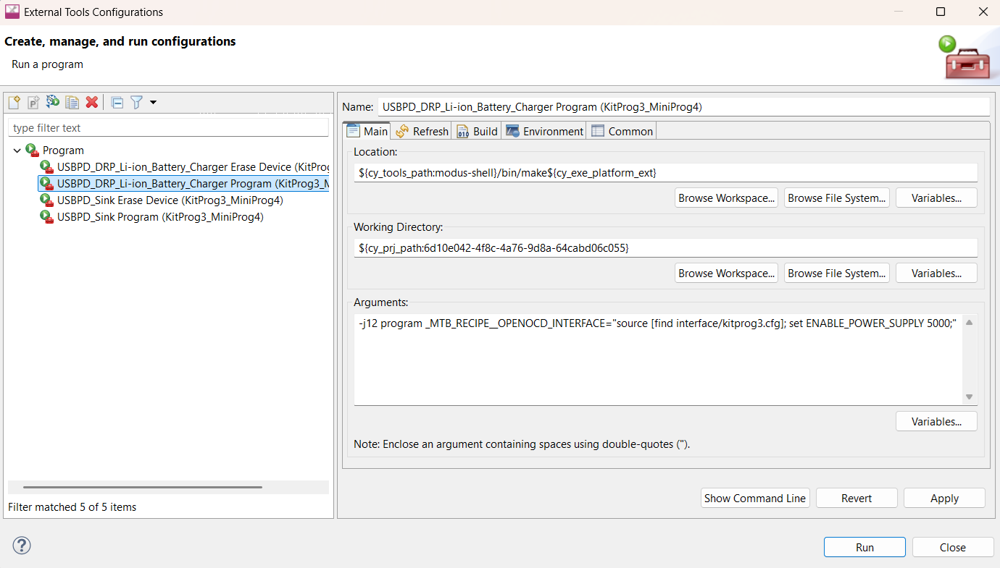
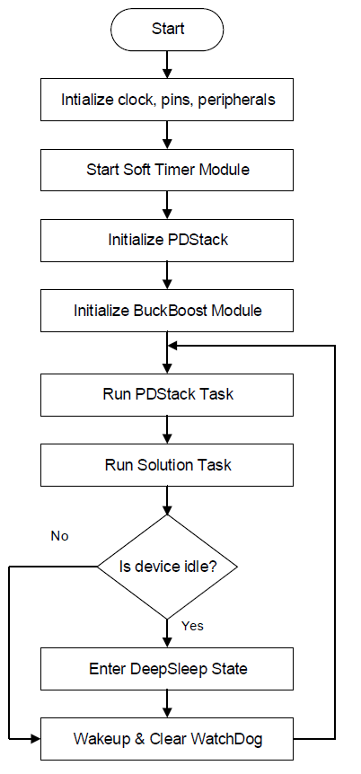
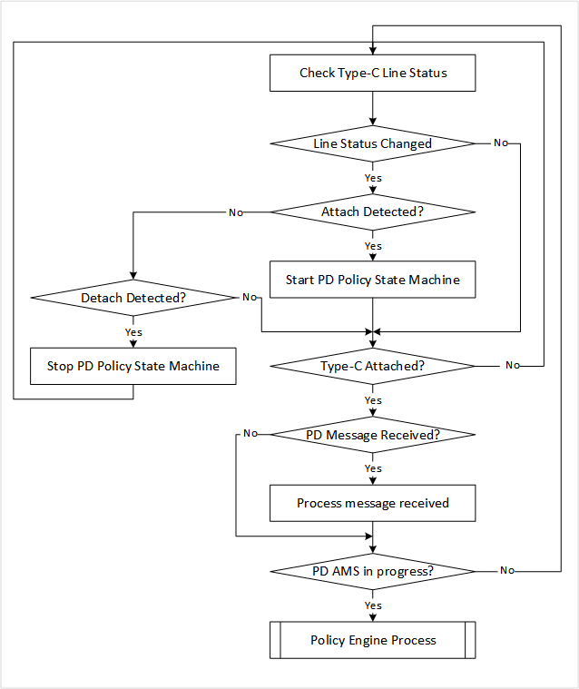
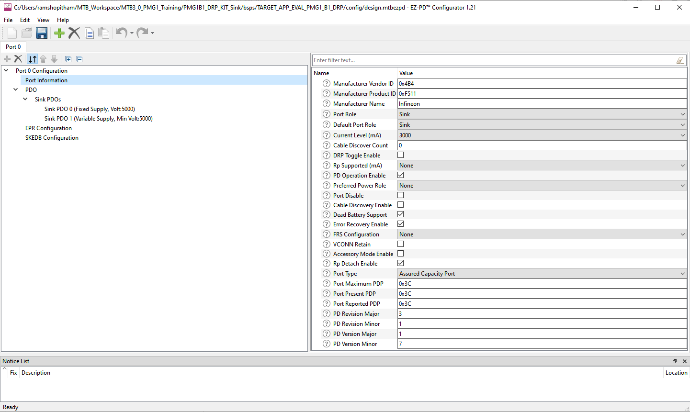
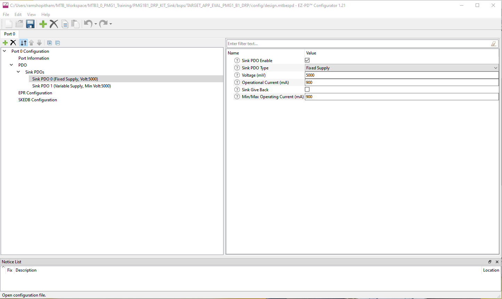
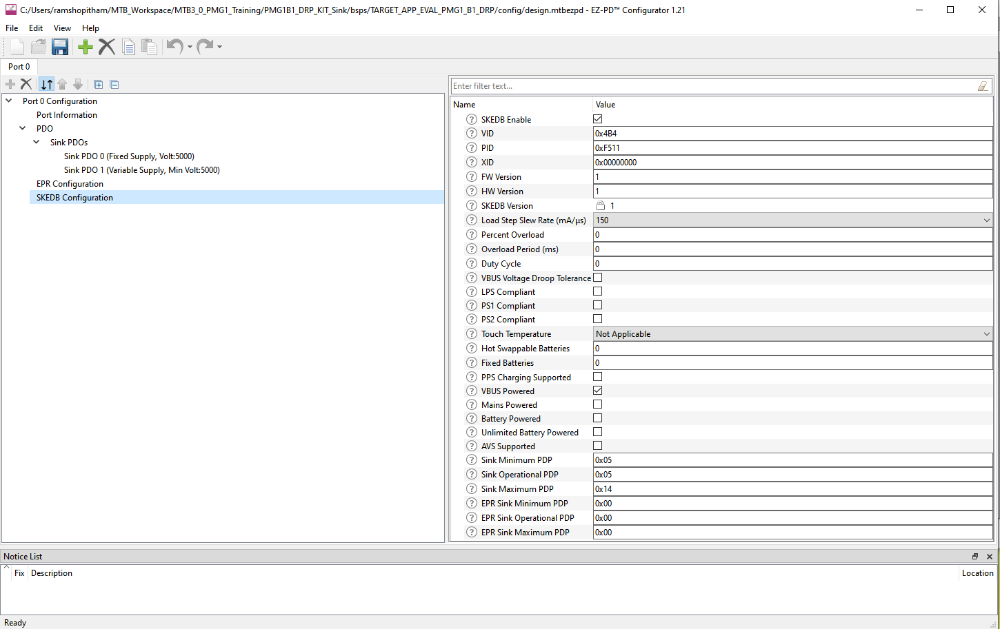

# EZ-PD&trade; PMG1-B2 MCU: USB PD sink

This code example demonstrates USB-C Power Delivery (PD) contract negotiation and constant voltage (CV) regulation of the output with the integrated buck-boost controller using EZ-PD&trade; PMG1-B2 device. It supports input USB-C power up to 240 W (48 V, 5 A) and provides a fixed output voltage of 24 V.

[View this README on GitHub.](https://github.com/Infineon/mtb-example-pmg1b2-usbpd-sink)

[Provide feedback on this code example.](https://yourvoice.infineon.com/jfe/form/SV_1NTns53sK2yiljn?Q_EED=eyJVbmlxdWUgRG9jIElkIjoiQ0UyNDM1ODUiLCJTcGVjIE51bWJlciI6IjAwMi00MzU4NSIsIkRvYyBUaXRsZSI6IkVaLVBEJnRyYWRlOyBQTUcxLUIyIE1DVTogVVNCIFBEIHNpbmsiLCJyaWQiOiJzdnlhdG9zbGF2LnBhbGl5QGluZmluZW9uLmNvbSIsIkRvYyB2ZXJzaW9uIjoiMS4wLjAiLCJEb2MgTGFuZ3VhZ2UiOiJFbmdsaXNoIiwiRG9jIERpdmlzaW9uIjoiTUNEIiwiRG9jIEJVIjoiV0lSRUQiLCJEb2MgRmFtaWx5IjoiVFlQRS1DIn0=)

## Requirements

- [ModusToolbox&trade; software](https://www.infineon.com/modustoolbox) v3.8 or later (tested with v3.8)
- Board support package (BSP) minimum required version: 3.6.0
- Programming language: C
- Associated parts: [EZ-PD&trade; PMG1-B2 MCU](https://www.infineon.com/PMG1-B2)

## Supported toolchains (make variable 'TOOLCHAIN')

- GNU Arm&reg; Embedded Compiler v14.2.1 (`GCC_ARM`) - Default value of `TOOLCHAIN`
- Arm&reg; Compiler v6.22 (`ARM`)
- IAR C/C++ Compiler v9.50.2 (`IAR`)

## Supported kits (make variable 'TARGET')

- [REF_PMG1_B2_DRP Rev03 solution board](https://www.infineon.com/evaluation-board/REF-PMG1-B2-DRP) (`REF_PMG1_B2_DRP`) - Default value of `TARGET`

## Hardware setup

1. Connect MiniProg4 programmer to J2 connector on the board for programming the EZ-PD&trade; PMG1-B2 device. Additionally, it is used during debugging

2. Ensure that the jumpers J4 is open and J5 is shorted

3. A USB PD power adapter is needed as the input DC power source for the board (J3)

4. A USB Type-C cable (preferably EPR) is needed to connect the USB PD adapter to the solution board

5. An electronic load or resistive load is needed to load the output terminal (J7)

See the [solution board user guide](https://www.infineon.com/ug242080) on the webpage for more details on configuring the board.


## Software setup

This code example does not need any additional software or tools however, [EZ-PD&trade; Protocol Analyzer Utility](https://www.infineon.com/evaluation-board/CY4500-EPR) can be used to analyze and debug the USB PD communication on the configuration channel (CC) line.

## Using the code example

### Create the project

The ModusToolbox&trade; tools package provides the Project Creator as both a GUI tool and a command line tool.

<details><summary><b>Use Project Creator GUI</b></summary>

1. Open the Project Creator GUI tool

   There are several ways to do this, including launching it from the dashboard or from inside the Eclipse IDE. For more details, see the [Project Creator user guide](https://www.infineon.com/ModusToolboxProjectCreator) (locally available at *{ModusToolbox&trade; install directory}/tools_{version}/project-creator/docs/project-creator.pdf*).

2. On the **Choose Board Support Package (BSP)** page, select a kit supported by this code example. See [Supported kits](#supported-kits-make-variable-target)

   > **Note:** To use this code example for a kit not listed here, you may need to update the source files. If the kit does not have the required resources, the application may not work.

3. On the **Select Application** page:

   a. Select the **Application(s) Root Path** and the **Target IDE**

   > **Note:** Depending on how you open the Project Creator tool, these fields may be pre-selected for you

   b. Select this code example from the list by enabling its check box

   > **Note:** You can narrow the list of displayed examples by typing in the filter box

   c. (Optional) Change the suggested **New Application Name** and **New BSP Name**

   d. Click **Create** to complete the application creation process

</details>

<details><summary><b>Use Project Creator CLI</b></summary>

The 'project-creator-cli' tool can be used to create applications from a CLI terminal or from within batch files or shell scripts. This tool is available in the *{ModusToolbox&trade; install directory}/tools_{version}/project-creator/* directory.

Use a CLI terminal to invoke the 'project-creator-cli' tool. On Windows, use the command-line 'modus-shell' program provided in the ModusToolbox&trade; installation instead of a standard Windows command-line application. This shell provides access to all ModusToolbox&trade; tools. You can access it by typing "modus-shell" in the search box in the Windows menu. In Linux and macOS, you can use any terminal application.
The following example clones the "[PMG1B2 USBPD Sink](https://github.com/Infineon/mtb-example-pmg1b2-usbpd-sink)" application with the desired name "MyUsbPdSink" configured for the *REF_PMG1_B2_DRP* BSP into the specified working directory, *C:/mtb_projects*:

   ```
   project-creator-cli --board-id REF_PMG1_B2_DRP --app-id mtb-example-pmg1b2-usbpd-sink --user-app-name MyUsbPdSink --target-dir "C:/mtb_projects"
   ```

The 'project-creator-cli' tool has the following arguments:

Argument | Description | Required/optional
---------|-------------|-----------
`--board-id` | Defined in the <id> field of the [BSP](https://github.com/Infineon?q=bsp-manifest&type=&language=&sort=) manifest | Required
`--app-id`   | Defined in the <id> field of the [CE](https://github.com/Infineon?q=ce-manifest&type=&language=&sort=) manifest | Required
`--target-dir`| Specify the directory in which the application is to be created if you prefer not to use the default current working directory | Optional
`--user-app-name`| Specify the name of the application if you prefer to have a name other than the example's default name | Optional

>**Note:** The project-creator-cli tool uses the `git clone` and `make getlibs` commands to fetch the repository and import the required libraries. For details, see the "Project creator tools" section of the [ModusToolbox&trade; software user guide](https://www.infineon.com/ModusToolboxUserGuide) (locally available at *{ModusToolbox&trade; software install directory}/docs_{version}/mtb_user_guide.pdf*).

To work with a different supported kit later, use the [Library Manager](https://www.infineon.com/ModusToolboxLibraryManager) to choose the BSP for the supported kit. You can invoke the Library Manager GUI tool from the terminal using the `make library-manager` command or use the Library Manager CLI tool "library-manager-cli" to change the BSP.

The "library-manager-cli" tool has the following arguments:

Argument | Description | Required/optional
---------|-------------|-----------
`--add-bsp-name` | Name of the BSP that should be added to the application | Required
`--set-active-bsp` | Name of the BSP that should be set as active BSP for the application | Required
`--add-bsp-version`| Specify the version of the BSP that should be added to the application if you do not wish to use the latest from manifest | Optional
`--add-bsp-location`| Specify the location of the BSP (local/shared) if you prefer to add the BSP in a shared path | Optional

<br>

The following example adds the REF_PMG1_B2_DRP BSP to the already created application and makes it the active BSP for the app:

   ```
   library-manager-cli --project "C:/mtb_projects/MyUsbPdSink" --add-bsp-name REF_PMG1_B2_DRP --add-bsp-version "latest-v3.X" --add-bsp-location "local"

   library-manager-cli --project "C:/mtb_projects/MyUsbPdSink" --set-active-bsp APP_REF_PMG1_B2_DRP
   ```

</details>

### Open the project

After the project has been created, you can open it in your preferred development environment.


<details><summary><b>Eclipse IDE</b></summary>

If you opened the Project Creator tool from the included Eclipse IDE, the project will open in Eclipse automatically.

For more details, see the [Eclipse IDE for ModusToolbox&trade; user guide](https://www.infineon.com/MTBEclipseIDEUserGuide) (locally available at *{ModusToolbox&trade; install directory}/docs_{version}/mt_ide_user_guide.pdf*).

</details>

<details><summary><b>Command line</b></summary>

If you prefer to use the CLI, open the appropriate terminal, and navigate to the project directory. On Windows, use the command-line 'modus-shell' program; on Linux and macOS, you can use any terminal application. From there, you can run various `make` commands.

For more details, see the [ModusToolbox&trade; tools package user guide](https://www.infineon.com/ModusToolboxUserGuide) (locally available at *{ModusToolbox&trade; install directory}/docs_{version}/mtb_user_guide.pdf*).

</details>

## Operation

1. Ensure that the steps listed in the [Hardware setup](#hardware-setup) section are complete

2. Program the board using one of the following:

   <details><summary><b>Using Eclipse IDE for ModusToolbox&trade; software</b></summary>

      1. Select the application project in the Project Explorer
	  
      2. Go to Run > External Tools > External Tool Configuration > Main
	  
      3. Enable MiniProg to supply power by adding the following script as shown in the below attached figure, -j12 program _MTB_RECIPE__OPENOCD_INTERFACE="source \[find interface/kitprog3.cfg\]; set ENABLE_POWER_SUPPLY 5000;"

      4. In the **Quick Panel**, scroll down, and click **\<Application Name> Program (KitProg3_MiniProg4)**
   </details>

   **Figure 1. Configure MiniProg to supply power while programming**

   

   <details><summary><b>Using CLI</b></summary>

      From the terminal, execute the `make program` command to build and program the application. The default toolchain and target are specified in the application's Makefile:
      ```
      set ENABLE_POWER_SUPPLY 5000
      make -j12 program
      ```

   </details>

3. Connect the USB PD power adapter to the USB PD port (J3) on the board

4. LED1 and LED3 indicate board is powered. The blinking status of LED2 (user LED) indicates the sink mode of operation. See **Table 1** for various user LED states

5. Measure and verify the fixed 24 V output voltage at J7 load terminal using a multimeter

6. Connect the DC electronic load or resistive load to J7 load terminal to draw current. The maximum supported load current is based on the negotiated USB PD input power <br> 
(Iout_max = Pin_max * efficiency / Vout)

7. To modify the output voltage to a different value, see the [EZ-PD&trade; PMG1-B2 battery charger application note](https://www.infineon.com/an242813)

**Table 1: User LED (LED2) states**
 Condition          | LED status
 :------------------ | :----------
 PD Sink mode | Blinks at 5 Hz 
 Fault | ON

<br>

## Debugging

You can debug the example to step through the code. In the IDE, use the **\<Application Name> Debug (KitProg3_MiniProg4)** configuration in the **Quick Panel**. Ensure that the board is connected to your PC using the USB cable connected to the programming/debugging port of the kit. See the "Debug mode" section in the kit user guide.

For more details, see the "Program and debug" section in the [Eclipse IDE for ModusToolbox&trade; software user guide](https://www.infineon.com/MTBEclipseIDEUserGuide).

## Design and implementation

EZ-PD&trade; PMG1 MCU devices support a USBPD block that integrates Type-C terminations, comparators, and the Power Delivery transceiver required to detect the attachment of a partner device and negotiate power contracts with it. In addition to the USBPD block, the EZ-PD&trade; PMG1 MCU also integrates a buck-boost controller subsystem that can convert the negotiated USB-C VBUS Voltage to required output. The output voltage is set in the hardware based on feedback resistor value.

On reset, the application initializes the USBPD block and buck-boost controller block with the following settings:

   - The receiver clock input of the block is connected to a 12 MHz PERI-derived clock

   - The transmitter clock input of the block is connected to a 600 kHz PERI-derived clock

   - The SAR ADC clock input of the block is connected to a 1 MHz PERI-derived clock

   - The SAR ADC in the USBPD block is configured to measure the VBUS_TYPE-C voltage through an internal divider

   - The buck-boost output voltage is initialized to 24 V

This application uses the PDStack Middleware Library in an upstream facing port (UFP) - sink configuration. EZ-PD&trade; PMG1 MCU devices have a dead-battery Rd termination, which ensures that a USB-C source/charger connected to it can detect the presence of a sink even when the EZ-PD&trade; PMG1 MCU device is not powered as shown in **Figure 2**.

**Figure 2. Firmware flowchart**


<br>

The PDStack Middleware Library configures the USBPD block on the EZ-PD&trade; PMG1 MCU device to detect Type-C connection state changes and USBPD messages, and notify the stack through callback functions. The callback function registers the pending tasks, which are then handled by PDStack through the `Cy_PdStack_Dpm_Task` function. This function is expected to be called at appropriate times from the main processing loop of the application.

**Figure 3. PDStack task flowchart**



<br>

The PDStack Middleware Library implements the state machines defined in the [USB-C Cable and Connector](https://www.usb.org/document-library/usb-type-cr-cable-and-connector-specification-revision-20) and the [USB Power Delivery](https://www.usb.org/document-library/usb-power-delivery) specifications. PDStack consists of the following main modules:

- **Type-C Manager:** Responsible for detecting a Type-C connection and identifying the type of connection. It uses the configurable Rp/Rd terminations provided by the USBPD block and the internal line state comparators. The Type-C manager implements the state machines defined in the **USB-C cable and connector specification** and provides the following functionality:

    - **Manage CC terminations**: Applies Rp/Rd terminations according to the port role

    - **Attach detection**: Perform the required debounce and determine the type of device attached

    - **Detach detection**: Monitor the CC line and VBus for detecting a device detach

- **Protocol layer:** Forms the messages used to communicate between a pair of ports/cable plugs. It is responsible for forming capabilities messages, requests, responses, and acknowledgements. It receives inputs from the Policy Engine indicating which messages to send and relays the responses back to the policy engine

- **Policy engine:** Provides a mechanism to monitor and control the USB Power Delivery system within a particular consumer, provider, or cable plug. It implements the state machines defined in the **USB Power Delivery** specification and contains implementations of all PD atomic message sequences (AMS). It interfaces with the protocol layer for PD message transmission/reception for controlling the reception of message types according to conditions such as the current state of the port. It also interfaces with the Type-C Manager for error conditions like Type-C error recovery

- **Device policy manager (DPM):** Provides an interface to the application layer to initialize, monitor, and configure the PDStack middleware operation. The DPM provides the following functionality:

    - Initialize the Policy Engine and Type-C Manager

    - Start the Type-C state machine followed by the Policy Engine state machine

    - Stop and disable the Type-C port

    - Allow entry/exit from Deep Sleep to achieve low-power based on the port status

    - Provide APIs for the application to send PD/Type-C commands

    - Provide event callbacks to the application for application-specific handling

The PDStack library uses a set of callbacks registered by the application to perform board-specific tasks such as turning the consumer power path ON/OFF and identifying the optimal source power profile to be used for charging. In this example, these functions are implemented using the appropriate APIs provided as part of the Peripheral Driver Library (PDL).

The stack also provides notification of various connection and PD policy state changes so that the rest of the system can be configured as required.

The application periodically measures the onboard temperatures and also monitors for any fault.

An over voltage (OV) comparator in the USBPD block is used to detect cases where the power source is supplying incorrect voltage levels, and automatically shutdown the power switches to protect the rest of the components on the board.

### Compile time configurations

Infineon's EZ-PD&trade; PMG1B2 MCU USBPD sink application functionality can be customized through a set of compile time parameters that can be turned ON/OFF through the *Makefile* file.

**Table 2: Compile time parameters**
 Macro name          | Description                           | Allowed values 
 :------------------ | :------------------------------------ | :------------- 
 `CY_PD_SINK_ONLY`     | Specifies that the application supports only the USBPD sink (consumer) role | Should be set to 1u 
 `CY_PD_REV3_ENABLE`   | Enable USB PD revision 3.2 support | 1u or 0u
 `SYS_DEEPSLEEP_ENABLE` | Enables device entry into deep sleep mode for power saving when the CPU is idle | 1u or 0u
 `DEBUG_PRINT_ENABLE` | Enables UART-based debug output | 1u or 0u

<br>

### PDStack Library selection

The USB Type-C Connection Manager, USB Power Delivery (USBPD) protocol layer, and USBPD device Policy Engine state machine implementations are provided in the form of pre-compiled libraries as part of the PDStack Middleware Library.

Multiple variants of the PDStack library with different feature sets are provided; you can choose the appropriate version based on the features required by the target application.

   - *PMG1_PD3_SNK_EPR*: Library with support for USB-C sink operation and USBPD revision 3.2 messaging with EPR support. By default, this library is chosen

   - *PMG1_PD2_SNK_LITE*: Library with support for USB-C sink operation and USBPD revision 2.0 messaging. Use this library to reduce the flash (code) memory usage by the application

The library of choice can be selected by editing the *Makefile* in the application folder and changing the value of the `COMPONENTS` variable. To use the PD revision 2.0 library, replace the `PMG1_PD3_SNK_EPR` reference with `PMG1_PD2_SNK_LITE`.


### USBPD port configuration

The properties of the USB-C port including the port role and the default response to various USBPD messages can be configured using the EZ-PD&trade; Configurator Utility.

These parameters have been set to the appropriate values for a Power Delivery sink application by default. To view or change the configuration, click the **EZ-PD&trade; Configurator 2.40** under **Tools** in the Quick Panel to launch the configurator.

**Figure 4. USB-C port configuration using EZ-PD&trade; configurator**



<br>

The properties of the USB-C port are configured using the **Port information** section. Because this application supports only the USBPD sink operation, the **Port role** is set as **Sink** and **DRP toggle** must be disabled. Other parameters such as **Manufacturer vendor ID** and **Manufacturer product ID** can be set to desired values.

The **Source PDO** and **SKEDB configuration** sections are not applicable for this application because only the sink operation is supported as shown in **Figure 5**.

**Figure 5. Sink capability configuration using EZ-PD&trade; Configurator**



<br>

The power capabilities supported by the application in the sink role are specified using the **Sink PDO** section. See the **USB Power Delivery** specification for details on how to encode the various sink capabilities. A maximum of seven PDOs can be added using the configurator.

**Figure 6. Extended sink capability configuration using EZ-PD&trade; Configurator**



<br>

The **SKEDB** section is used to input the extended sink capabilities response that is sent by the application when queried by the power source. See the Power Delivery specification for more details on the extended sink capabilities format.

Once the parameters have been updated as desired, save the configuration and build the application.

For quick verification of the application configurability, disable the **PD operation** parameter under **Port information**. When the EZ-PD&trade; PMG1 MCU device is programmed with this modification, observe that the user LED blinks at a slower rate even when connected to a power source which supports USB Power Delivery.

### Resources and settings

**Table 3. Application resources**

| Resource  | Alias/object   | Purpose                               |
| :-------  | :------------  | :------------------------------------ |
| USBPD | PD_PORT0 | USBPD block used for PD communication |
| SCB3 | UART | UART interface to output debug information |


### List of application files and their usage
 **Table 4. Application file and its usage**
| File                         | Purpose                               |
| :--------------------------- | :------------------------------------ |
| *cy_solution.c & .h* | Defines data structures, function prototypes and implements solution layer functions |

<br>

## Related resources

Resources | Links
-----------|------------------
Application notes |[AN232553](https://www.infineon.com/AN232553) – Getting started with EZ-PD&trade; PMG1 MCU on ModusToolbox&trade; software <br> [AN242984](https://www.infineon.com/an242984) – EZ-PD&trade; PMG1-B2 hardware design guidelines <br> [AN242813](https://www.infineon.com/an242813) – EZ-PD&trade; PMG1-B2 battery charger application note
Code examples | [Using ModusToolbox&trade; software](https://github.com/Infineon?q=mtb-example-pmg1%20NOT%20Deprecated) on GitHub
Device documentation | [EZ-PD&trade; PMG1-B2 MCU datasheet](https://www.infineon.com/pmg1b2)
Development kits | Select your kits from the [Evaluation board finder](https://www.infineon.com/cms/en/design-support/finder-selection-tools/product-finder/evaluation-board)
Libraries on GitHub | [mtb-pdl-cat2](https://github.com/Infineon/mtb-pdl-cat2) – Peripheral Driver Library (PDL) and docs
Middleware on GitHub  | [pdstack](https://github.com/Infineon/pdstack) – PDStack Middleware Library and docs <br> [pdutils](https://github.com/Infineon/pdutils) – PDUtils Middleware Library and docs
Tools |  [ModusToolbox&trade;](https://www.infineon.com/modustoolbox) – ModusToolbox&trade; software is a collection of easy-to-use libraries and tools enabling rapid development with Infineon MCUs for applications ranging from wireless and cloud-connected systems, edge AI/ML, embedded sense and control, to wired USB connectivity using PSoC&trade; Industrial/IoT MCUs, AIROC&trade; Wi-Fi and Bluetooth&reg; connectivity devices, XMC&trade; Industrial MCUs, and EZ-USB&trade;/EZ-PD&trade; wired connectivity controllers. ModusToolbox&trade; incorporates a comprehensive set of BSPs, HAL, libraries, configuration tools, and provides support for industry-standard IDEs to fast-track your embedded application development.
Additional documents | Refer to the application notes, reference manuals, hardware design guidelines, and all [EZ-PD™ PMG1-B2 MCU documentation on this webpage](https://www.infineon.com/products/universal-serial-bus/usb-c-high-voltage-microcontrollers/ez-pd-pmg1-b2-battery-charge-controller-with-usb-c-pd-mcu).

## Other resources


Infineon provides a wealth of data at [www.infineon.com](https://www.infineon.com) to help you select the right device, and quickly and effectively integrate it into your design.


## Document history

Document title: *CE243585* – *EZ-PD&trade; PMG1-B2 MCU: USB PD sink*

 Version | Description of change
 ------- | ---------------------
 1.0.0   | New code example

<br>

All referenced product or service names and trademarks are the property of their respective owners.

PSOC&trade;, formerly known as PSoC&trade;, is a trademark of Infineon Technologies. Any references to PSoC&trade; in this document or others shall be deemed to refer to PSOC&trade;.  

(c) 2026, Infineon Technologies AG, or an affiliate of Infineon Technologies AG. All rights reserved.
This software, associated documentation and materials ("Software") is owned by Infineon Technologies AG or one of its affiliates ("Infineon") and is protected by and subject to worldwide patent protection, worldwide copyright laws, and international treaty provisions. Therefore, you may use this Software only as provided in the license agreement accompanying the software package from which you obtained this Software. If no license agreement applies, then any use, reproduction, modification, translation, or compilation of this Software is prohibited without the express written permission of Infineon.
<br>
Disclaimer: UNLESS OTHERWISE EXPRESSLY AGREED WITH INFINEON, THIS SOFTWARE IS PROVIDED AS-IS, WITH NO WARRANTY OF ANY KIND, EXPRESS OR IMPLIED, INCLUDING, BUT NOT LIMITED TO, ALL WARRANTIES OF NON-INFRINGEMENT OF THIRD-PARTY RIGHTS AND IMPLIED WARRANTIES SUCH AS WARRANTIES OF FITNESS FOR A SPECIFIC USE/PURPOSE OR MERCHANTABILITY. Infineon reserves the right to make changes to the Software without notice. You are responsible for properly designing, programming, and testing the functionality and safety of your intended application of the Software, as well as complying with any legal requirements related to its use. Infineon does not guarantee that the Software will be free from intrusion, data theft or loss, or other breaches (“Security Breaches”), and Infineon shall have no liability arising out of any Security Breaches. Unless otherwise explicitly approved by Infineon, the Software may not be used in any application where a failure of the Product or any consequences of the use thereof can reasonably be expected to result in personal injury.
